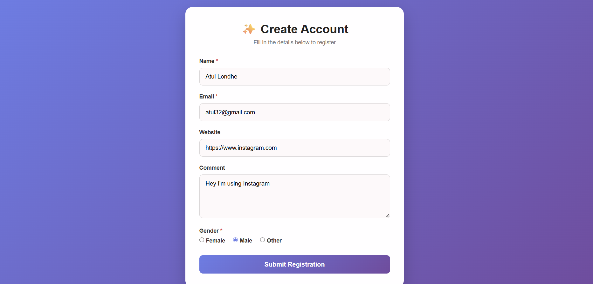
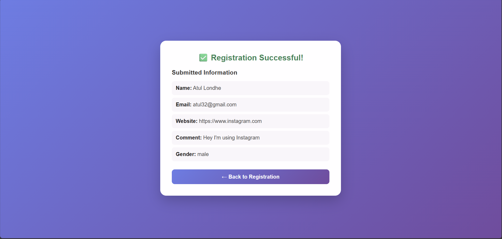
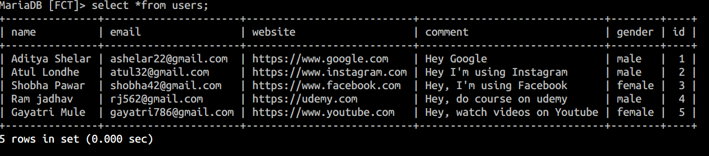

# PHP Registration Form on AWS EC2

A responsive registration form built with **HTML, CSS, JavaScript, and PHP**, deployed on an **AWS EC2 instance** using **Nginx** and connected to **Amazon RDS for MariaDB**. The EC2 instance uses **Amazon EBS** for persistent block storage.

The application collects user details, displays a registration-success page, and stores submitted records in a MariaDB database.

## Project Preview

Add your screenshots to a folder named `screenshots/` in this repository, then update the image paths below.

| Registration Form | Registration Success | Database Records |
|---|---|---|
|  |  |  |

## Architecture

```text
                         User / Web Browser
                                  |
                                HTTP/HTTPS
                                  |
                           Nginx Web Server
                           on AWS EC2
                                  |
                         PHP Application Logic
                                  |
                       Amazon RDS for MariaDB
                         (Database Service)

                  Amazon EBS → EC2 block storage
```

**Request flow:** The user submits the registration form → Nginx serves the application and passes PHP requests to the configured PHP runtime → PHP processes the submitted data → the application stores the record in MariaDB → the result is shown to the user.

> **Note:** Amazon EBS provides block storage attached to the EC2 instance. MariaDB is shown as a separate database service; if you installed MariaDB directly on EC2 instead of using Amazon RDS, update this description and the architecture accordingly.

## Features

- Responsive registration form interface
- Fields for name, email, website, comment, and gender
- PHP-based form processing
- MariaDB database integration
- Registration confirmation page
- Deployment on an AWS EC2 Linux instance
- Nginx web server configuration
- EC2 storage backed by Amazon EBS

## Technology Stack

| Layer | Technology |
|---|---|
| Frontend | HTML5, CSS3, JavaScript |
| Backend | PHP |
| Web server | Nginx |
| Database | MariaDB |
| Compute | Amazon EC2 |
| Storage | Amazon EBS |
| Cloud platform | Amazon Web Services (AWS) |

## Database Structure

The application uses a `users` table to store submitted registration information.

| Column | Description |
|---|---|
| `id` | Unique record identifier |
| `name` | Registered user's name |
| `email` | User's email address |
| `website` | Website URL |
| `comment` | User's comment |
| `gender` | Selected gender |

Example query to view stored records:

```sql
SELECT * FROM users;
```

## Deployment Overview

The project was deployed on AWS using the following high-level workflow:

1. **Launch an EC2 instance** with a suitable Linux AMI.
2. **Configure security groups** to allow only the required traffic, such as SSH for administration and HTTP/HTTPS for web access.
3. **Attach and configure EBS storage** for the instance as required.
4. **Install and configure Nginx** to serve the web application.
5. **Install PHP and the required PHP-FPM/database extensions** compatible with the chosen Linux distribution.
6. **Deploy the application files** to the configured web root and set appropriate file permissions.
7. **Configure MariaDB connectivity** and create the database and `users` table.
8. **Configure Nginx and PHP-FPM**, validate the configuration, and restart or reload the relevant services.
9. **Test the application** by submitting the form and verifying that the record is stored in the database.

Exact installation commands vary by Linux distribution and by whether MariaDB is hosted on Amazon RDS or directly on EC2.

## Example Project Structure

```text
php-registration-form/
├── index.php                 # Registration form
├── process.php               # Form processing and database insert
├── success.php               # Registration confirmation page
├── css/
│   └── style.css              # Page styling
├── js/
│   └── script.js              # Client-side interactions/validation
├── screenshots/
│   ├── registration-form.png
│   ├── registration-success.png
│   └── database-records.png
└── README.md
```

Your actual filenames may differ. Adjust this tree to match your repository.

## Security Considerations

- Keep database credentials outside publicly accessible source files where possible.
- Never commit passwords, private keys, `.env` files, or other secrets to GitHub.
- Use prepared statements (for example, PDO or MySQLi) for database queries.
- Validate input on the server side; browser-side validation alone is not sufficient.
- Restrict database access to the application server or approved network sources.
- Allow SSH only from trusted IP addresses and use HTTPS for production traffic.
- Avoid displaying detailed PHP errors to public visitors in production.

## What I Learned

- Deploying a PHP web application on an AWS EC2 Linux instance
- Configuring Nginx to serve a PHP-based application
- Connecting a web application to a MariaDB database
- Understanding the role of Amazon EBS in EC2 storage
- Testing form submissions and verifying database records
- Applying basic cloud networking and deployment practices

## Future Improvements

- Add stronger server-side validation and duplicate-email checks
- Hash passwords if account authentication is introduced
- Configure HTTPS with a valid TLS certificate
- Add logging, monitoring, backups, and database access controls
- Automate deployment using a CI/CD pipeline

## Author

**Aditya Annasaheb Shelar**

Cloud Computing | AWS | Linux | PHP | Web Application Deployment

---

*This project was developed for learning and demonstrating web application deployment on AWS. Do not use it with real personal information until appropriate security, privacy, and production controls are implemented.*
